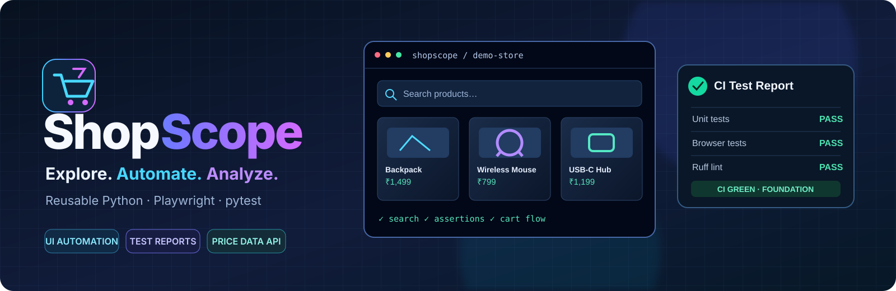
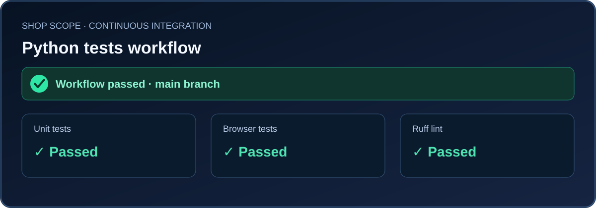

# ShopScope

<p align="center">
  
</p>

<p align="center">
  <strong>Reusable Python · Playwright · pytest</strong><br>
  E-commerce UI automation framework with a controlled demo storefront and a future provider-based price-tracking extension.
</p>

<p align="center">
  <a href="https://github.com/sonukkushwaha0801/shopscope-playwright/actions/workflows/tests.yml"></a>
  
  
  
</p>

## CI result

The latest successful GitHub Actions run confirms the workflow completed successfully. This graphic is a summary visual, not a raw screenshot of the GitHub Actions UI.

<p align="center">
  
</p>

[View the live workflow and run history](https://github.com/sonukkushwaha0801/shopscope-playwright/actions).

---

**Explore. Automate. Analyze.**

A reusable Python Playwright framework for e-commerce UI automation, with a deterministic local demo storefront, a provider interface for future approved integrations, and a price-comparison service.

**Status:** The initial framework foundation is implemented. No live Amazon India or Flipkart automation is implemented.

## Included

- Environment-based settings and validation.
- pytest fixtures for browser, isolated contexts, and pages.
- Page-object pattern and a bundled local storefront.
- Unit and end-to-end tests.
- Failure screenshots and Playwright trace capture.
- Normalized offer model and provider protocol for approved data sources.
- Decimal-based price comparison logic.
- GitHub Actions matrix for Python 3.12, 3.13, and 3.14, plus Ruff linting.

## Windows setup (VS Code / PowerShell)

Run these commands from the cloned repository directory:

```powershell
py -3.14 -m venv .venv
.\.venv\Scripts\Activate.ps1
python -m pip install --upgrade pip
python -m pip install -e ".[test,dev]"
python -m playwright install chromium
```

If PowerShell blocks activation, use the virtual environment interpreter directly instead of changing execution policy:

```powershell
.\.venv\Scripts\python.exe -m pip install -e ".[test,dev]"
.\.venv\Scripts\python.exe -m playwright install chromium
```

## Run checks

```powershell
python -m pytest tests/unit
python -m pytest tests/e2e
python -m pytest
ruff check .
```

Browser tests use the bundled local HTML storefront and do not sign in to retailer sites or place orders. Install the Playwright browser binary before running end-to-end tests.

## Configuration

Settings are read from environment variables. `.env.example` documents supported values; the project does not automatically load a `.env` file.

| Variable | Default | Purpose |
|---|---|---|
| `SHOP_SCOPE_ENV` | `local` | Environment label |
| `SHOP_SCOPE_BROWSER` | `chromium` | Browser: chromium, firefox, or webkit |
| `SHOP_SCOPE_HEADLESS` | `true` | Set to `false` to show the browser |
| `SHOP_SCOPE_BASE_URL` | `https://playwright.dev` | Default base URL for future application tests |
| `SHOP_SCOPE_NAV_TIMEOUT_MS` | `15000` | Navigation timeout in milliseconds |
| `SHOP_SCOPE_ACTION_TIMEOUT_MS` | `5000` | Action timeout in milliseconds |
| `SHOP_SCOPE_ARTIFACTS_DIR` | `test-results` | Failure artifact directory |

## Failure artifacts

On browser test failure, the fixture attempts to save a screenshot and Playwright trace in `test-results/`. Open a trace with `python -m playwright show-trace <trace-file>`. Artifacts may contain page content; inspect them before sharing.

## Retailer and price-data boundaries

Amazon India and Flipkart are the intended learning context, not assumed automation targets. Before implementing retailer-specific automation or collecting prices, verify applicable terms and use an approved API, licensed data source, or explicit permission where required.

The project does not implement CAPTCHA evasion, stealth techniques, access-control circumvention, rate-limit bypasses, or real purchases. The provider interface keeps approved data sources separate from browser tests and shared framework code.

## License

MIT. See [LICENSE](LICENSE).
